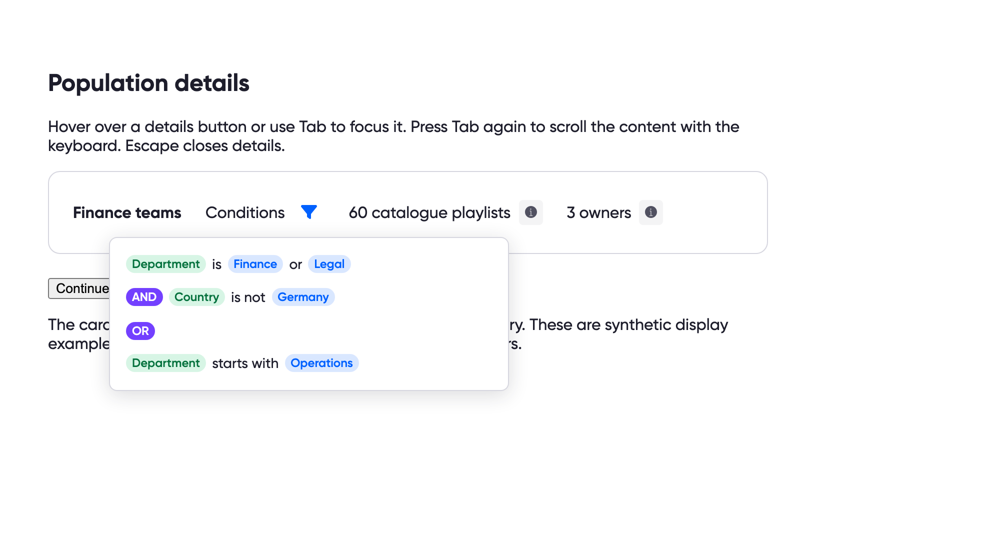
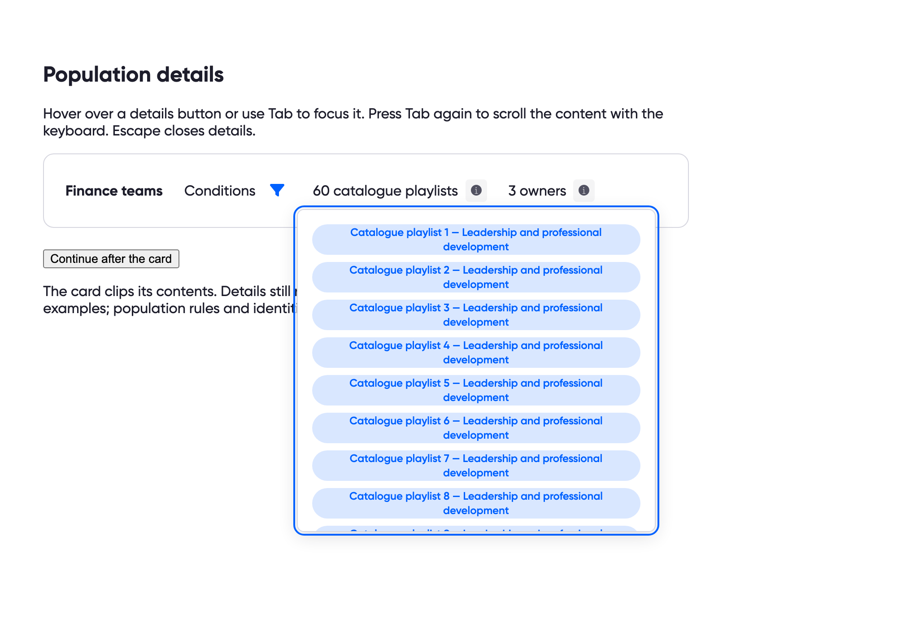
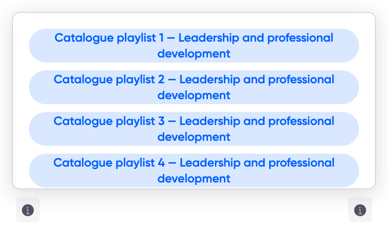

# POP-012 — Accessible rich tooltip

Branch: `feat/pop-012-accessible-tooltip`, created from Components `master` at `4f52bbef968550e7d25b3ddea1764b9cbf5e7f12`. This ticket depends on the [POP-001 contracts](https://github.com/CoorpAcademy/app-backoffice/pull/1362), independently of POP-011.

## Scope and ownership

Extend the existing `atom/tooltip` with an optional interactive mode for population-card details. The caller supplies tags, conditions, identities, playlist names, labels and permissions. No business data, API calls, population parsing or persistent state is owned here. Internal state is limited to visibility, positioning and focus.

Legacy tooltips and the externally anchored `anchorId` path keep their existing behavior. No new dependency is introduced. Conditions summaries, production person tags and population cards belong to subsequent tickets; the fixtures here illustrate the shared popup with synthetic data.

## Props

| Prop | Interactive mode |
|---|---|
| `interactive?: boolean` | New, opt-in; defaults to false. Applies to local triggers without `anchorId`. |
| `TooltipContent` | Existing prop: a React node or a component function. Content keeps its tag markup. Components are rendered normally, not called to inspect their return value. |
| `aria-label` | Name of the trigger and popup. Supply a meaningful label, such as “Membership conditions”. |
| `closeToolTipInformationTextAriaLabel` | Existing caller-supplied keyboard instructions, connected to the popup with `aria-describedby`. |
| `placement` | Preferred `left`, `right`, `top` or `bottom`; defaults to left. Flips and clamps when space is insufficient. |
| `delayHide` | Existing prop, default 250 ms; allows crossing the gap from trigger to popup. Focus inside either region keeps it open. |
| `AnchorElement` | Existing custom-trigger component. Forward the supplied accessibility attributes to a native button or equivalent focusable element. This allows a conditions pictogram instead of an information icon. |
| `iconContainerClassName`, `tooltipClassName`, `iconSize` | Existing presentation options. The rich surface has its own scoped styling. |

```jsx
<Tooltip
  interactive
  aria-label="Catalogue playlists"
  closeToolTipInformationTextAriaLabel="Press Escape to close playlist details"
  placement="bottom"
  TooltipContent={() => <PlaylistNameTags items={playlists} />}
/>
```

`PlaylistNameTags` above represents caller-owned display content, not a new export of this ticket. No permission or playlist lookup is performed by Tooltip.

## Interaction and placement

| Action | Result |
|---|---|
| Hover, focus or click the trigger | Opens details. |
| Move from trigger to popup | Cancels delayed closing; the content remains readable and scrollable. |
| Tab from the trigger | Focuses the scrollable surface. Native arrow/Page/End keys can scroll it. |
| Tab within content containing links | Moves through those links. |
| Shift+Tab at the beginning | Returns to the trigger. |
| Tab at the end | Continues after the trigger in document order, skipping hidden/disabled controls and the portalled content. |
| Escape | Closes details and restores trigger focus when leaving the popup. It does not immediately reopen. |
| Outside pointer press or focus departure | Closes without stealing focus from the outside control. |

The rich surface is rendered in `document.body` using a fixed portal, so a clipped card cannot hide it. Placement preserves a 12 px viewport margin and an 8 px anchor gap where possible. Long content scrolls within a 360 px maximum height, reduced further for short viewports. Resize, ancestor scroll and ResizeObserver measurements update positioning. Timers, observers and listeners are cleaned up on closure/unmount.

The rich mode uses a **non-modal dialog** because keyboard users can enter it and its content may contain focusable links. WAI-ARIA's [tooltip guidance](https://www.w3.org/WAI/ARIA/apg/patterns/tooltip/) distinguishes that case from a tooltip that never receives focus. There is no focus trap, backdrop or background scroll lock. Closed tooltips render safely on the server without mounting the floating layout effect.

The surface uses existing Coorpmanager typography and a white background to retain colored-tag readability. It introduces no movement animation.

## Visual review

Generate fixtures with `npm run generate`. Review these synthetic stories:

- `atom-tooltip-population-details--rich-details`: clipped card, green/blue/purple condition tags, 60 catalogue playlists, illustrative owners.
- `atom-tooltip-population-details--viewport-edges`: each viewport corner, long content and resizing.
- Generated Tooltip stories include the existing simple/external modes and the three new rich-content fixtures.

No backend or production identity is used by these examples. Storybook evidence does not establish connected App/API acceptance.

The captures below come from the local Chrome checks, with the official fonts loaded.







## Verification

Commands, test scope, source hashes, coverage and browser results are recorded in [POP-012-verification.json](POP-012-verification.json). Coverage is scoped to Tooltip's four runtime JS files, not the complete package.

| Check | Result |
|---|---|
| Full Components package lint and TypeScript | Passed; 0 errors, 44 existing warnings |
| Explicit lint of the manual visual story and updated fixture | Passed |
| Affected Tooltip and shared-consumer tests | 127 passed |
| Four-file coverage | 99.4% lines, 98.94% statements, 100% functions, 96.72% branches |
| Focused Storybook production export | Passed |
| Native Chrome interactions | Passed: pointer crossing, Tab order, Escape/focus, outside click, End scrolling to the last playlist, viewport corners and open resizing |

The full package suite was not rerun: its existing Lottie animation-fetch failure was reproduced on the same clean `master` commit during POP-011. This ticket reports the affected scope above and does not claim a green complete suite or remote Chromatic results.
